# Foundation - Wails v3 桌面应用脚手架

## 项目愿景

`foundation` 是一个开箱即用的跨平台桌面应用脚手架，基于 Wails v3 + React 19 + Mantine 9，为新项目提供：

- 已分层的 Go 后端（`internal/app` + `internal/services` + `internal/events`）
- 已分平台的窗口配置（Windows/Linux 无边框前端自绘，macOS 沉浸式标题栏保留红绿灯）
- 已落地的前端 MVVM 规范（每个组件 / 页面独立文件夹，View / ViewModel / Style 三件分离）
- 已实现的可切换布局系统（9 种内置布局预设：图标栏 / 展开侧栏 / 顶部导航 / 融合标题栏 / 右侧栏 / 底部 Dock / 悬浮 Dock / 浮动卡片 / 专注，CSS Grid 外壳，可注册自定义预设）+ 方圆按钮主题
- README 中的「改名引导」让使用者一步把脚手架变成自己的项目

## 架构总览

- 后端：Go 1.26（Wails v3.1.0 要求），`main.go` 仅做 `embed.FS` + `app.Run`，业务装配集中在 `internal/app`。
- 前端：React 19 + TypeScript（strict）+ Mantine 9（`@mantine/core` / `@mantine/charts` on recharts / `mantine-datatable`）+ `@tabler/icons-react` + Vite 8。主题为注册式预设，统一在 `frontend/src/styles/themes/`（`buildMantineTheme.ts` 把 `FoundationPalette` 编译为 CSS 变量 `--fd-*` + Mantine 主色 `foundation`），全局样式 `frontend/src/styles/global.css`；组件样式用 CSS Modules（`<Name>.module.css`）。
- 通信：通过 `wails3 generate bindings` 生成 `frontend/bindings/foundation/...`，前端 `services/` 层包装。
- 构建：根 `Taskfile.yml` 调用各平台子 Taskfile（Windows/macOS/Linux/iOS/Android/Docker）。
- 布局：外壳 `components/AppLayout` 是 CSS Grid（`title` / `nav` / `main` 区域），由**布局预设**（`frontend/src/layouts/`，`nav.variant × nav.placement × frame`）经 `data-placement` / `data-frame` / `data-dock-side` 切换；导航组件统一在 `components/Navigation`（NavRail / NavSidebar / NavBar / NavDock / NavigationDrawerButton）。当前预设持久化在 preferences 表（`layout` / `navCollapsed` / `floatDockSide` / `floatDockY`）。标题栏高度为 CSS 变量 `--fd-titlebar-h`（macOS 40px 与红绿灯居中对齐，见 `internal/app/window_darwin.go` 的 `macTitleBar()`；其它平台 36px）。
- 测试：Go 单测（`internal/services/exportsvc`）+ Playwright E2E（`frontend/e2e/`，跑 Wails server 模式二进制 + `FOUNDATION_DATA_DIR` 隔离数据目录）。

通信链路：

```
React 组件 (View)
    └── ViewModel (use<Page>)
        └── services/GreetService.ts
            └── @bindings/foundation/internal/services/greet (Wails 生成)
                └── 后端 internal/services/greet.Greet

后端 internal/events/events.go (RegisterEvent[string]("time"))
    └── internal/app/app.go: app.Event.Emit("time", ...)
        └── 前端 shared/hooks/useTimeEvent.ts (Events.On)

布局预设 / 启动就绪
    PreferencesProvider（从 SQLite 读回 layout 等偏好 → ready=true）
        └── AppLayout: useLayoutPreset() → layoutRegistry.resolve(preferences.layout) → CSS Grid data-* 属性
        └── useAppLayout: ready → signalAppReady()（shared/appReady.ts）
            └── main.tsx 监听 foundation:app-ready（兜底 1500ms）→ 淡出 index.html 启动骨架

后端 internal/events/events.go (RegisterEvent[string]("appsettings:changed") = AppSettingsChanged)
    └── internal/services/appsettings 任一 setter 写库成功: app.Event.Emit("appsettings:changed", "<字段名>")
        └── 前端 services/appsettings/AppSettingsService.onChanged (Events.On)
            ├── FoundationThemeProvider（themeChoice / customTheme，200ms 防抖后重拉）
            └── I18nProvider（localeChoice，重拉）
            → 主窗口 / 子窗口（child.tsx）/ 托盘面板（systrayEntry.tsx）主题、语言实时同步
```

## 模块结构图

```mermaid
graph TD
    A["foundation (根)"] --> M["main.go"]
    A --> I["internal/"]
    A --> F["frontend/"]
    A --> B["build/"]

    I --> IA["internal/app/<br/>app.go + window_*.go + childwindow.go + systray*.go"]
    I --> IS["internal/services/<br/>greet / preferences / appsettings / storagesvc / exportsvc / subprocess"]
    I --> IE["internal/events/events.go"]
    I --> IT["internal/storage/<br/>SQLite + GORM + AutoMigrate"]
    I --> IU["internal/utils/<br/>httpx / procx / cryptox / logx / filex"]

    F --> FC["src/components/<br/>AppLayout / TitleBar / Navigation / Skeleton / x-pro"]
    F --> FL["src/layouts/<br/>布局预设 + layoutRegistry"]
    F --> FP["src/pages/<br/>HomePage / SettingsPage(personalization,layout,language,database)"]
    F --> FE["e2e/<br/>Playwright（server 模式）"]
    F --> FS["src/services/<br/>greet / preferences / appsettings / storage / dialogs / export / subprocess / childwindow / systray"]
    F --> FT["src/styles/themes/<br/>(Mantine theme + --fd-* CSS 变量)"]
    F --> FB["bindings/ (生成)"]

    B --> B1["windows / darwin / linux / ios / android / docker"]

    click F "./frontend/CLAUDE.md" "查看 frontend 模块文档"
    click B "./build/CLAUDE.md" "查看 build 模块文档"
```



## 模块索引

| 模块 | 路径 | 语言/技术 | 一句话职责 |
|------|------|-----------|------------|
| 应用入口 | `main.go` | Go | 仅含 `embed.FS` 与 `app.Run(assets)`，业务下沉到 `internal/` |
| 应用启动 | `internal/app/` | Go | 服务注册、平台窗口配置、事件循环、子窗口（ChildWindowService）、系统托盘（SystrayService，`systray*.go` 分平台） |
| 业务服务 | `internal/services/` | Go | Wails Service（每个领域一个子包：greet / preferences / appsettings / storagesvc / exportsvc（表格导出 CSV / XLSX）/ subprocess） |
| 持久化层 | `internal/storage/` | Go + GORM | SQLite 打开 / PRAGMA / AutoMigrate / 路径配置（含 `FOUNDATION_DATA_DIR` 覆盖）/ Holder |
| 工具层 | `internal/utils/` | Go | httpx（HTTP）/ procx（子进程 + JobObject）/ cryptox（AES-GCM）/ logx（slog + rotate）/ filex（原子写） |
| 事件契约 | `internal/events/` | Go | 集中注册类型化事件，前后端共享名称 |
| 前端 UI | `frontend/` | React 19 + Mantine 9 + TS | 用户界面、调用 Service、订阅事件 |
| 布局系统 | `frontend/src/layouts/` + `components/AppLayout` + `components/Navigation` | TS + CSS Grid | 布局预设注册 / 外壳网格 / 导航形态（详见 `.claude/skills/foundation-layout/SKILL.md`） |
| E2E 测试 | `frontend/e2e/` + `frontend/playwright.config.ts` | Playwright | 驱动 server 模式真实后端 + 前端；README 截图生成 |
| 多平台构建 | `build/` | Taskfile / Gradle / Shell / nfpm | 各平台打包脚本与资源 |

## 运行与开发

前置条件：Go 1.26+、Node.js + pnpm、`wails3` CLI、`task` (go-task)。

| 命令 | 说明 |
|------|------|
| `wails3 dev` 或 `task dev` | 前后端热重载（Vite 端口默认 9245） |
| `wails3 generate bindings` | 重新生成 `frontend/bindings/<module>/...` |
| `task build` | 当前 OS 生产构建 |
| `task package` | 当前 OS 打包 |
| `cd frontend && pnpm install` | 首次或更新依赖后 |
| `cd frontend && pnpm typecheck` | TypeScript 类型检查 |
| `cd frontend && pnpm build` | 前端单独生产构建 |
| `go build .` | 后端单独构建（需要 `frontend/dist` 已存在） |
| `go test ./internal/...` | Go 单元测试 |
| `wails3 task build:server` | 构建 server 模式二进制 `bin/foundation-server`（无 GUI，纯 HTTP；E2E 前置） |
| `cd frontend && pnpm e2e` | Playwright E2E（自动启动 `bin/foundation-server`，数据目录隔离到 `.e2e-data/`） |
| `cd frontend && pnpm e2e:screenshots` | 重新生成 README 截图到 `docs/screenshots/` |

## 改名 / 业务化指南

由于 `foundation` 既是模块名又是 bindings 路径前缀，改名顺序很关键：

1. 改 `go.mod` 的 `module foundation` → `module <你的名字>`
2. 全局替换 `import "foundation/internal/app"` 为新模块名
3. 改前端 `services/greet/GreetService.ts` 中的 `@bindings/foundation/...` 路径
4. 跑 `go mod tidy` 与 `wails3 generate bindings`
5. 改 `build/config.yml` 的 `info.*` 字段并 `wails3 task common:update:build-assets`
6. 改 `Taskfile.yml` 的 `APP_NAME`、`internal/app/app.go` 的 `Name/Description`、`frontend/src/App.tsx` 的 title

完整对照表见 [README.md](./README.md)。

## 持久化（SQLite + GORM）

> 详细使用指南见 `.claude/skills/foundation-persistence/SKILL.md`（加表三步、业务 service 接入、路径切换、表统计与清空、Provider 异步化模式、反例）。

应用所有跨会话状态存到 `~/Library/Application Support/Foundation/foundation.db`（macOS）/ `%AppData%\Foundation\foundation.db`（Windows）/ `~/.local/share/Foundation/foundation.db`（Linux），位置可由用户在「设置 → 数据存储」里改。配置文件 `storage.json` 与默认数据库放在同目录（独立于 db）。

**数据根目录覆盖**：设置环境变量 `FOUNDATION_DATA_DIR=<dir>`（`internal/storage/paths.go` 的 `DataDirEnv`）后，数据根直接用该目录（不再拼 `AppDirName`）；`cryptox` 主密钥放同目录、`logx` 日志写 `<dir>/logs`。用于便携版 / E2E / server 模式隔离数据。

**驱动 / ORM**：`modernc.org/sqlite`（纯 Go，无 CGO 需求）+ `gorm.io/gorm` + `github.com/glebarez/sqlite`（GORM 对接 modernc 的适配）。

**关键 PRAGMA**：WAL / `synchronous=NORMAL` / `busy_timeout=5000` / `cache_size=-64000` / `mmap_size=256MB` / `temp_store=MEMORY` / `foreign_keys=ON`。

**模型注册中心**：`internal/storage/models.go` 的 `AllModels` 数组。**加新表零迁移文件**：

```
1. 在 internal/storage/ 写 GORM 结构体（建议新文件 models_<domain>.go 拆开）
2. 把 &YourModel{} 追加到 AllModels
3. 重启 → AutoMigrate 自动建表 / 加列 / 加索引
```

GORM AutoMigrate **不会**做：删列、删表、重命名字段；这些保留旧 schema 不丢数据。需要重命名字段时业务方手写一次性数据迁移钩子。

**业务 service 接入持久化**：

```go
// internal/services/<domain>/<domain>.go
type Service struct {
    holder *storage.Holder // 不要 capture *storage.DB —— 切换路径会替换它
}

func (s *Service) DoSomething(ctx context.Context) error {
    return s.holder.Current().GORM.WithContext(ctx).Save(...).Error
}
```

切换路径时（`storagesvc.SetCustomPath`）会原子替换 holder 内的 DB 指针，业务 service 继续从 `holder.Current()` 取永远拿到活跃句柄。

## 测试策略

- **Go 单元测试**：`internal/services/exportsvc/exportsvc_test.go`（CSV / XLSX 导出）。新增测试放 `internal/services/<domain>/<name>_test.go`，`go test ./internal/...`。
- **E2E（Playwright）**：`frontend/playwright.config.ts` + `frontend/e2e/`
  - 被测对象是 Wails **server 模式**二进制（`wails3 task build:server` → `bin/foundation-server`，`-tags server`，无原生窗口，纯 HTTP），即真实 Go 后端 + 真实前端；Playwright `webServer` 每次先清空再启动，`FOUNDATION_DATA_DIR` 指向隔离目录 `.e2e-data/`（已 gitignore），绝不碰用户真实数据库。
  - 浏览器默认 `channel: 'msedge'`（用本机已装的 Edge，免 `playwright install`）；环境变量 `E2E_CHANNEL`（CI 可设 `chromium` 并预装）/ `E2E_PORT`（默认 9346，传给 `WAILS_SERVER_PORT`）/ `E2E_DATA_DIR`。串行执行（`workers: 1`，共用一个后端）。
  - `e2e/helpers.ts`：`openApp`（等 `#startup-skeleton` 消失 = 偏好已读回）、`chooseLayout`（经设置页切换布局预设）。
  - `e2e/floating-dock.spec.ts`：悬浮 Dock 拖到任意位置都留在内容区内（不进标题栏 / 红绿灯）、松手后手柄仍可拖、刷新后位置持久化。
  - `e2e/screenshots.spec.ts`：用 `sqlite3` 直接写 E2E 库的 preferences / app_settings 后刷新，生成 9 种布局 / 页面 / 主题 / 托盘面板 / 子窗口截图到 `docs/screenshots/`（`pnpm e2e:screenshots`；需本机有 `sqlite3`，标题栏按 Windows 渲染）。
- 尚无前端单元测试；如需可加 Vitest（配 React Testing Library）覆盖 ViewModel hook。

## 编码规范

- Go：`gofmt`、`go vet`，按 `internal/` 分层，跨文件夹引用走 import 而非相对路径。
- 前端：见 [frontend/DEVELOPMENT.md](./frontend/DEVELOPMENT.md)（MVVM、文件夹规约、theme-only 配色、方圆设计）。
- 文件路径：仓库内统一正斜杠。`.gitignore` 已忽略 `bin`、`frontend/dist`、`frontend/node_modules`、`frontend/bindings`、`.task`、`.e2e-data`、`frontend/test-results`、`frontend/playwright-report`。

## AI 使用指引

- **分层准则**：业务逻辑写到 `internal/services/<domain>/`，启动配置写到 `internal/app/`，事件名集中在 `internal/events/events.go`，持久化模型集中在 `internal/storage/models.go`，跨业务横切关注点放 `internal/utils/<name>/`。`main.go` 不接受任何业务代码追加。
- **平台分支**：窗口配置走 `internal/app/window_<os>.go` 的 build tag 文件，不要在 `app.go` 里写 `runtime.GOOS` 判断。
- **持久化铁律**：跨会话状态**只能走 SQLite**（前端 `PreferencesService` / `AppSettingsService`，或自己加业务 service）。**禁止**前端用 `localStorage` / `sessionStorage`。后端业务 service 持有 `*storage.Holder`，**不要** capture `*storage.DB`（切换路径会替换它）。加新表只需把 `&Model{}` 追加到 `internal/storage/models.go` 的 `AllModels`，重启自动 AutoMigrate。详见 `.claude/skills/foundation-persistence/SKILL.md`。
- **工具层铁律**（详见 `.claude/skills/foundation-utils/SKILL.md`）：
  - **HTTP**：禁止 `net/http.DefaultClient` / `http.Get/Post`；用 `httpx.GetJSON` / `httpx.PostJSON` / `httpx.Do`
  - **子进程**：禁止 `os/exec.Cmd.Start` 直接用；用 `procx.StartCtx` / `procx.Run`（自动绑 Windows JobObject / Unix pgid）
  - **加密**：敏感字符串落 SQLite **必须**先 `cryptox.EncryptString`
  - **日志**：禁止 `log.Printf` / `fmt.Println`；用 `logx.For("component").Info(...)`
  - **配置文件**：禁止 `os.WriteFile` 写配置；用 `filex.WriteAtomic`
  - **前端调子进程**：必须经 `internal/services/subprocess` 白名单，**禁止**给前端开万能 `RunCommand`
- **前端调用边界**：组件 → ViewModel hook → `services/<Domain>Service.ts` → `@bindings/<module>/...`。View 不许直接 import bindings；ViewModel 不许直接 import bindings。
- **原生对话框铁律**：所有"打开 / 保存 / 选择文件夹 / 确认 / 错误提示"必须走 `NativeDialogs`（封装 Wails v3 `Dialogs.*`）。**禁止**使用浏览器 `alert` / `confirm` / `prompt` / `<input type="file">`。
- **Icon 铁律**：UI 中所有图标必须用 `@tabler/icons-react` 的 React 组件（`<IconXxx size={20} stroke={1.75} />`，路由 `icon` 字段类型为 `Icon`）。**禁止** emoji、Unicode 符号、内联 `<svg>` 字面量、其它 icon 包（`@mui/icons-material` / `react-icons` / `lucide-react` 等）当图标。详见 `frontend/CLAUDE.md` 的「Icon 规范」与 `.claude/skills/foundation-mantine-icons/SKILL.md`。
- **样式取色**：样式写在 `<Name>.module.css`（CSS Modules），颜色永远用 `var(--fd-*)`；JS 侧需要引用颜色（图表 `color`、内联 style）用 `FOUNDATION_CSS_VARS.*`，必须拿真实色值（canvas 等）才用 `useFoundationPalette()`。除 `styles/themes/presets/*.ts` 外禁止硬编码十六进制，也不要给 Mantine 组件传内置色名（如 `color="blue"`）。圆角语言：按钮 4–6px（Mantine `radius="sm"` / 自绘 6px）/ 容器 8px（`radius="md"`），不用圆形按钮（详见 `frontend/CLAUDE.md` 与 `.claude/skills/foundation-theme/SKILL.md`）。
- **UI 组件**：只用 Mantine（`@mantine/core` / `@mantine/hooks`），图表用 `@mantine/charts`（高级图表见 `components/x-pro/charts`），表格用 `components/x-pro/data-grid`（基于 `mantine-datatable`，列定义 `DataGridColumn<T>`）。**禁止**重新引入 `@mui/*` / `@emotion/*` / `sx` 写法。详见 `.claude/skills/foundation-mantine/SKILL.md`（及 `foundation-mantine-components` / `-charts` / `-datatable`）。
- **i18n 铁律**：任何"人类可见字符串"必须经 `t('key')` —— JSX 文本、`aria-label`、`placeholder`、Tooltip、按钮文字、错误文案、对话框标题 / 消息 / 按钮、常量字符串都不允许硬编码。新增页面必须配套 `pages/<Name>/lang/{<code>.ts}` 并在 `App.tsx` 注册。详见 `.claude/skills/foundation-i18n/SKILL.md`。
- **布局铁律**：新的导航位置 / 外壳组合 = 在 `frontend/src/layouts/presets.ts` 加一行预设（或业务侧 `layoutRegistry.register(...)`），必要时在 `AppLayout.module.css` 按 `data-placement` / `data-frame` 加网格规则；**禁止**在 `AppLayout.tsx` / 页面里硬编码布局分支或写死导航组件。导航条目只来自路由表（`useNavigation`）。标题栏高度只用 `var(--fd-titlebar-h)`；改 macOS 标题栏高度必须同步 `internal/app/window_darwin.go`（`InvisibleTitleBarHeight` / `macTitleBar()`）。详见 `.claude/skills/foundation-layout/SKILL.md`。
- **设置页子目录隔离**：`SettingsPage/<sub>/` 每个子页面独立目录（含 View / VM / Style / lang），文案命名空间 `settings.<sub>.*`，子页面之间不互相 import。详见 `frontend/CLAUDE.md` 的「设置页：子目录隔离规范」。
- **改名提醒**：`module foundation` 一旦改动，必须同步前端 import + bindings 重新生成 + Taskfile 的 APP_NAME；`internal/storage/AppDirName` / `internal/utils/cryptox/AppDirName` / `internal/utils/logx/AppDirName` 也要同步改成新业务名（决定数据 / 密钥 / 日志目录）。

## 变更记录 (Changelog)

- 2026-05-28 13:09:44：初始化文档结构。
- 2026-05-28（升级）：Go module 重命名 `changeme → foundation`；后端拆分为 `internal/{app,services,events}/`；前端升级 React 19 + MUI 9 + TypeScript；引入 MVVM 规范；新增 Discord 风格三栏布局与自绘标题栏；分平台窗口配置（Windows/Linux 无边框，macOS 沉浸式）。
- 2026-05-28（i18n）：前端新增国际化系统 `frontend/src/i18n/`，内置 `zh-CN`（默认）/ `en-US`；公用文案与页面级文案分离（`src/i18n/locales/` + `src/pages/<Name>/lang/`）；新增 `<I18nProvider>` / `useT()`；TitleBar / Sidebar / 路由 label / 现有页面全部接入 `t()`；设置页拆出"语言"独立入口；新增 `foundation-i18n` SKILL，确立"人类可见字符串必须走 t()"铁律。
- 2026-05-28（首屏骨架）：消除启动白屏 —— `frontend/index.html` 内联静态骨架（webview 立即可见，跟随系统明暗），React mount 后 160ms 淡出移除；新增通用骨架组件 `src/components/Skeleton/`，HomePage / SettingsPage 各配版式骨架；`RouteDefinition` 增加 `fallback` 字段；`SettingsPage` 改 `React.lazy` 拆独立 chunk，主 bundle 减小约 17KB。
- 2026-05-28（持久化迁移 SQLite）：新增 `internal/storage/`（modernc/sqlite + GORM AutoMigrate + WAL + 单连接池）；新增三个 Wails service —— `preferences`（KV）、`appsettings`（单行表，主题 / 自定义主题 / 语言）、`storagesvc`（路径管理 / 切换 / 重置）；前端 Provider 全异步化，**移除全部 localStorage**；新增 `NativeDialogs` 服务封装 Wails 原生对话框，禁用浏览器 alert/confirm/prompt；设置页新增「数据存储」子页面（原生「另存为」对话框 + 重置确认），并按子目录隔离规范重构（`personalization/` / `language/` / `database/` 各自独立 View / VM / Style / lang）。
- 2026-05-28（数据可视化 + 表清理）：`internal/storage/models.go` 引入 `ModelDescriptor`（labelKey / clearable）；`storagesvc` 新增 `GetTableStats`（dbstat 精确字节，回退按行数估算）+ `ClearTable`（白名单 + clearable 校验）；前端升级 `@mui/x-charts@^9.3.0`，数据存储页新增双图（PieChart 占比 + 横向 BarChart 字节）+ 逐表清空（带原生确认对话框）；新增 Icon 规范铁律：UI 图标必须用 `@mui/icons-material`，禁止 emoji / Unicode 符号 / 第三方 icon 包。
- 2026-05-28（工具层）：新增 `internal/utils/`：`httpx`（HTTP 客户端 + JSON helper + 重试，单例 client）、`procx`（子进程 + Windows JobObject / Unix setpgid，父进程崩溃连带 kill）、`cryptox`（AES-GCM 对称加密，主密钥 ~/.../<App>/.master.key）、`logx`（slog + 控制台 + 文件 rotate）、`filex`（原子写、限长读）；新增 `internal/services/subprocess` 白名单子进程 service（前端可调，命令必须在 commands.go 注册并通过 ArgPattern 校验）；改造 `storage/config.go` 走 filex.WriteAtomic 保护 storage.json；新增 `foundation-utils` SKILL。
- 2026-08-17（Wails 升级 alpha.96 → beta.9）：`go.mod` 升到 `github.com/wailsapp/wails/v3 v3.0.0-beta.9`（`go mod tidy` 自动移除已折叠进 v3 的独立 `webview2` indirect 依赖）；前端 `@wailsio/runtime` 由 `"latest"` **锁定**为 `3.0.0-beta.9`（避免 beta 期间 latest 漂移），bindings 用 beta.9 CLI 重新生成。**无业务代码改动**——项目用到的整套 application/events/window/systray API 在 beta.9 签名不变（`internal/...` 全部 `go build` + `go vet` 通过，前端 `pnpm typecheck` 通过）。同步更新 `.claude/skills/` 下 Wails 知识库到 beta.9：修正 `wails-bindings` 破坏性变更（2 参 `NewService(x, ServiceOptions{})` → `NewServiceWithOptions`；`time.Time` 默认映射由 `Date` 改为 RFC3339Nano 字符串、`[]byte`→base64 字符串、新增 `-time-type` flag）；`wails-runtime-features` 修正 `KeyBinding`「global」措辞并新增 `app.GlobalShortcut`（系统级快捷键）、前端 `System.IsMobile/IsDesktop/...` 平台检测、通知增强字段（Sound/Attachments/ThreadID/InterruptionLevel/Schedule）；`wails-window` 补 `WindowsWindow.DisableMenu` 与 macOS `Mac.CornerType/CornerRadius`；`wails-application` 新增 `application.System` 平台检测；`wails-advanced` 新增 Streams（`app.HandleStream`）与内置 MCP Server（`mcp` tag）两节 + 官方 `streams.md`/`streams-from-websockets.md` 参考；`wails-overview/references/changelog.md` 与 `INDEX.md` 基准刷新到 beta.9。
- 2026-11-06（Wails v3.1.0 + Mantine）：`go.mod` 升到 `github.com/wailsapp/wails/v3 v3.1.0`（v3.0.0 GA 后首个 weekly；`go 1.26.0`），`@wailsio/runtime` 锁 `3.1.0`，Go API 面零改动；`build/` 资产按 v3.1.0 模板同步（各平台 Taskfile / Docker / Android / iOS / 新增 dmg 资源，修正 `foundation.exe` 命名），`build/config.yml` info.* 对齐为实际值，根 Taskfile 增加 `GOOS` 分发与 `install:msix:tools`。前端 UI 库 **MUI 9 → Mantine 9.7.5**：主题改为 `buildMantineTheme`（`--fd-*` CSS 变量 + `foundation` 主色阶 + 语义变量映射），样式文件 `<Name>.styles.ts` → `<Name>.module.css`；图标 `@mui/icons-material` → `@tabler/icons-react`；图表 `@mui/x-charts` → `@mantine/charts`（recharts 3），x-pro 八种高级图表改为封装原生组件（Gantt 保留 SVG）；x-pro DataGridPro/Premium 基于 `mantine-datatable` 重写（列类型 `DataGridColumn<T>`，全部 Pro/Premium 功能保留，表格文案独立 i18n）；移除全部 `@mui/*` / `@emotion/*`；`foundation-mui*` 11 个 skill 替换为 `foundation-mantine` / `-components` / `-icons` / `-charts` / `-datatable`。
- 2026-11-06（v1.0.0 收尾）：**系统托盘端到端可用**（Go `SystrayService` Enable/Disable/IsEnabled/SetMenuLabels，开关持久化到 preferences `systray.enabled` 并启动恢复，面板失焦 / Esc 隐藏，托盘菜单文案走 i18n，面板「打开设置」驱动主窗口路由；移除 `src/settings.ts`）；**表格导出走原生「另存为」**（新增 `internal/services/exportsvc`：CSV 带 BOM / excelize 生成真 `.xlsx`，`filex.WriteAtomic` 落盘；前端 `services/export/ExportService`）；DataGrid 新增列菜单（排序 / 钉住 / 隐藏 / 管理列）、列宽拖拽、钉住行按实测行高定位；漏斗图支持横向；x-pro 图表独立语言包 `registerXProChartsLocales`，演示数据全部 i18n；**跨窗口设置同步**（后端 appsettings 写入后广播 `appsettings:changed`，主窗口 / 子窗口 / 托盘面板的主题与语言实时一致，子窗口不再固定 light）；分包修复（Vite 8 用 `rolldownOptions`，懒加载页骨架独立 `*.skeleton.module.css`、语言包从 `<sub>/lang` 导入，首屏不再预加载 recharts / datatable）；应用版本以 `build/config.yml` 为唯一事实源（前端 `__APP_VERSION__`），升到 **1.0.0**；GORM 日志忽略 record-not-found；wails-* skill 同步到 v3.1.0 文档（M-Press `docs/mpress/content`）；新增 `docs/MIGRATION-v1.md` 迁移指南。
- 2026-11-06（**v2.0.0** 布局系统 + E2E）：新增**布局预设系统** `frontend/src/layouts/`（`LayoutPreset` = `nav.variant` × `nav.placement` × `frame`，9 个内置预设 classic（默认）/ sidebar / topnav / titlebar / right / dock / floating / inset / focus，`layoutRegistry.register` 扩展，持久化到 preferences `layout` + `navCollapsed` / `floatDockSide` / `floatDockY`）；`AppLayout` 重写为 CSS Grid（`data-placement` / `data-frame` / `data-dock-side` 切换）；新增 `components/Navigation`（NavRail / NavSidebar / NavBar / NavDock / NavigationDrawerButton + 共享 `useNavigation`），`components/Sidebar` 改为 NavRail 的兼容出口；悬浮 Dock 可拖拽（指针捕获、夹取在内容区内不进 macOS 标题栏、双击手柄复位）；TitleBar 新增 `leading` / `center` 插槽，高度改为 `--fd-titlebar-h`（macOS 40px，`window_darwin.go` 改用 `MacToolbarStyleUnifiedCompact` + `InvisibleTitleBarHeight: 40` 使红绿灯垂直居中；`index.html` 首帧前写 `data-platform`）；设置页新增「布局」子页面（CSS 缩略图卡片 radiogroup + 折叠侧栏开关）；首页改为响应式卡片网格并新增「当前布局」卡片；路由 `navigate(id, params?)` + `params`（设置页读 `params.section`）；启动骨架改为等偏好读回（`PreferencesProvider.ready` → `signalAppReady` → `main.tsx`，兜底 1500ms），消除布局跳变；后端新增 `FOUNDATION_DATA_DIR` 覆盖数据 / 密钥 / 日志根目录；新增 Playwright E2E（server 模式二进制 + 隔离数据目录，`pnpm e2e` / `pnpm e2e:screenshots` → `docs/screenshots/`）；新增 `foundation-layout` SKILL。
